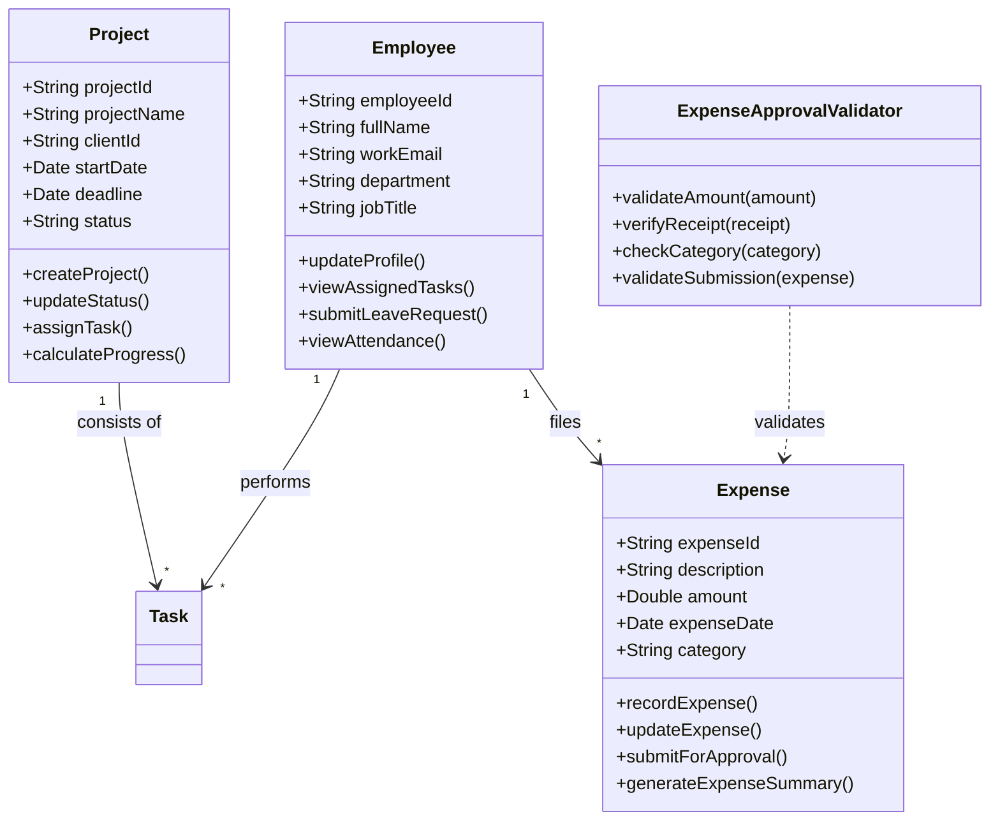

# Assignment 01 (Lab 02): From Real-World Concept to Software Object

> **Course:** Software Design & Architecture (SEC-532)  
> **Student Name:** Khawaja Absar Ali  
> **Roll Number:** 2025-SE-31  
> **Instructor:** Engr. Ghulam Rabbani Butt  
> **Semester:** 3rd Semester (Session 2025–29)  
> **University:** The University of Azad Jammu and Kashmir, Muzaffarabad  
> **Submission Date:** October 26, 2026  
> **Document:** [`Assignment_1.pdf`](./Assignment_1.pdf)

---

## 📋 Overview

This assignment focuses on the transition from real-world business concepts to software objects through **conceptual modeling** and **domain abstraction**. Using a **Company Management System** as the real-world domain, candidate conceptual classes were identified, core classes were modeled with attributes and behaviors, abstraction boundaries were established, and an invented software object was introduced to handle business validation logic.

---

## 🏢 1. Selected Domain: Company Management System

A company must coordinate numerous interconnected operational entities simultaneously:
- Employees and their departments
- Clients, active projects, and associated tasks
- Financial flows: expenses, client invoices, and payment receipts
- Human resource tracking: daily attendance records and leave requests

Without a formalized conceptual structure, communication fails, tasks get delayed, and critical financial/operational data can be lost. The goal of this conceptual model is to organize and unify these operations into cohesive abstractions prior to software implementation.

---

## 📦 2. Candidate Conceptual Classes

Ten conceptual classes were identified from the business domain. Each class represents a meaningful real-world entity rather than an implementation construct (such as a database table, UI view, or API endpoint):

| # | Conceptual Class | Real-World Representation & Responsibility |
|---|-------------------|---------------------------------------------|
| 1 | **`Employee`** | Represents an individual working for the organization; manages personal details, department affiliation, and assigned responsibilities. |
| 2 | **`Department`** | Represents functional units (e.g., Development, Design, Marketing) to group employees by role and workflow. |
| 3 | **`Client`** | Represents external entities or individuals contracting the company for services; tracks relationship details and agreements. |
| 4 | **`Project`** | Represents client-commissioned deliverables; monitors progress, milestones, deadlines, and task allocation. |
| 5 | **`Task`** | Represents an atomic work unit within a project, assigned to specific personnel with an tracked status. |
| 6 | **`Expense`** | Captures organizational expenditure, including timestamp, category, amount, and business purpose. |
| 7 | **`Invoice`** | Represents formal billing sent to clients, recording amounts due, terms, and payment status. |
| 8 | **`Payment`** | Records verified financial transactions (incoming client receipts or outgoing vendor settlements). |
| 9 | **`AttendanceRecord`** | Tracks daily employee presence, timestamps, and check-in/out records for auditing. |
| 10 | **`LeaveRequest`** | Manages formal employee requests for time off, containing dates, justifications, and approval states. |

---

## 🔍 3. Detailed Class Modeling: Attributes & Methods

Three core classes essential to day-to-day operations were selected for detailed object modeling:

### 3.1 `Employee` Class
- **Attributes:**
  - `employeeId`: Unique identifier distinguishing each employee.
  - `fullName`: Full legal name of the employee.
  - `workEmail`: Official corporate email address for correspondence.
  - `department`: Functional unit to which the employee is assigned.
  - `jobTitle`: Designated designation/position within the company hierarchy.
- **Methods:**
  - `updateProfile()`: Updates employee contact, personal, or role data.
  - `viewAssignedTasks()`: Retrieves currently allocated project tasks.
  - `submitLeaveRequest()`: Dispatches a leave request to HR/management.
  - `viewAttendance()`: Displays historical attendance records.

### 3.2 `Project` Class
- **Attributes:**
  - `projectId`: Unique project identifier.
  - `projectName`: Descriptive title of the project.
  - `clientId`: Foreign identifier of the contracting client.
  - `startDate`: Project commencement date.
  - `deadline`: Expected delivery/completion target date.
  - `status`: Lifecycle phase (e.g., *Planned*, *In Progress*, *Completed*).
- **Methods:**
  - `createProject()`: Initializes and persists a new project entity.
  - `updateStatus()`: Modifies the project lifecycle state based on milestones.
  - `assignTask()`: Delegates a task to an assigned team member.
  - `calculateProgress()`: Aggregates subtask statuses to compute completion percentage.

### 3.3 `Expense` Class
- **Attributes:**
  - `expenseId`: Unique identifier for the recorded expense.
  - `description`: Detailed explanation of the incurred cost.
  - `amount`: Monetary value expended.
  - `expenseDate`: Date the expense was incurred.
  - `category`: Classification tag (e.g., *Software License*, *Hardware/Equipment*, *Travel*).
- **Methods:**
  - `recordExpense()`: Logs a newly incurred expense record.
  - `updateExpense()`: Modifies details of an existing draft expense.
  - `submitForApproval()`: Routes the expense item into the managerial approval pipeline.
  - `generateExpenseSummary()`: Aggregates expense metrics for departmental financial reviews.

---

## 🎯 4. Main Abstraction Decisions

Effective conceptual design requires setting deliberate boundaries:

1. **Why `Employee`, `Project`, and `Expense`?**
   - These three concepts form the operational backbone of service-based businesses: people doing work, delivering client solutions, and managing cash flow. The remaining classes support or interact with these primary objects.
2. **Deliberate Scoping Exclusions:**
   - Complex domains such as payroll tax calculations, legal compliance, candidate recruitment pipelines, and advanced inventory tracking were deliberately omitted to maintain a focused conceptual boundary.
3. **Domain vs. Implementation Separation:**
   - In accordance with pure conceptual modeling, technical components (e.g., SQL tables, database connection pools, HTTP request routers, login controllers, HTML/CSS UI components) were intentionally excluded. The focus remains on real-world business semantics.

---

## 💡 5. Invented Software Object: `Expense Approval Validator`

In object-oriented software architecture, real-world concepts are not always sufficient to coordinate business logic cleanly. **Invented software objects** (pure fabrications / service objects) are created to enforce rules and prevent bloating domain entities:

- **Object Name:** `Expense Approval Validator`
- **Nature:** An invented service abstraction with no direct physical real-world counterpart.
- **Responsibilities & Purpose:**
  - Enforces expense governance policies before submission to management.
  - Verifies that the monetary amount is positive and within allowable policy thresholds.
  - Ensures a mandatory receipt or proof of purchase is attached.
  - Confirms mandatory justification and valid categorization.
- **Architectural Benefits:**
  - Decouples validation business logic from the `Expense` data model (Single Responsibility Principle).
  - Ensures consistent validation across various organizational workflows.
  - Prevents fraudulent or incomplete submissions from reaching finance managers.

---

## 🎓 6. Conclusion & Key Takeaways

1. **Conceptual Clarity Before Code:** Identifying domain entities and clarifying their boundaries early prevents architectural debt and chaotic dependencies.
2. **Pure Fabrication has High Value:** Not every class in an object-oriented system maps directly to a tangible real-world item; invented software objects are vital for orchestration, validation, and policy enforcement.
3. **Foundation for Architecture:** This conceptual model establishes the building blocks for subsequent stages, including UML Class Diagrams, Sequence Diagrams, and architectural design patterns.
